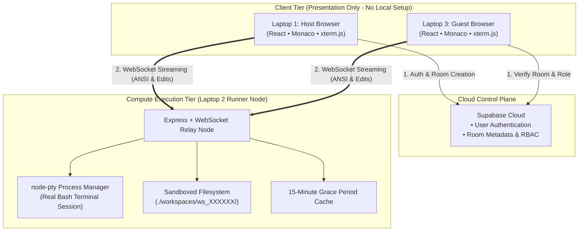

# EnvOS 🪐
### Browser-Native Collaborative Cloud Operating System & Virtual Workspace

EnvOS turns the browser into a high-performance, real-time collaborative development operating system. By decoupling the presentation layer from the execution plane, it gives developers a lightweight, fluid desktop OS experience with zero cloud hosting bills.

---

## 🌟 Key Features

- **Liquid Glass Desktop**: Apple-inspired frosted windowing manager with draggable, resizable windows, traffic light controls, and a macOS-style floating dock.
- **Code Studio**: Fully integrated Monaco/VS Code-grade editor with multi-tab support and syntax highlighting.
- **Cloud Shell**: Ultra-low-latency real-time bash terminal powered by `xterm.js` and `node-pty`.
- **Decoupled Architecture**: All heavy compute (compilation, bash, `node_modules`, git operations) runs on a dedicated local runner node rather than expensive, sleep-prone cloud VMs.
- **Multiplayer Collaboration**: Real-time room joining with 6-character room codes.
- **Role-Based Access Control (RBAC)**: Fine-grained permissions for Host, Editor, and Viewer roles.
- **Session Persistence**: 15-minute grace period ensuring background terminals remain alive during client reconnection or device handoff.

---

## 🏗️ Architecture Overview



---

## 📂 Project Structure

```
EnvOS/
├── apps/
│   ├── docs/          # Documentation powered by Fumadocs
│   ├── web/           # Browser-native Desktop OS frontend
│   └── runner/        # Dedicated Node.js + node-pty Compute Runner
├── GIT_GUIDELINES.mdx # Git branching, commit, and PR rules
└── README.md
```

---

## 📜 Git Guidelines

Strict Git rules are enforced for this repository. Please refer to [GIT_GUIDELINES.mdx](./GIT_GUIDELINES.mdx) before contributing or opening PRs. Direct pushes to `main` are prohibited.
